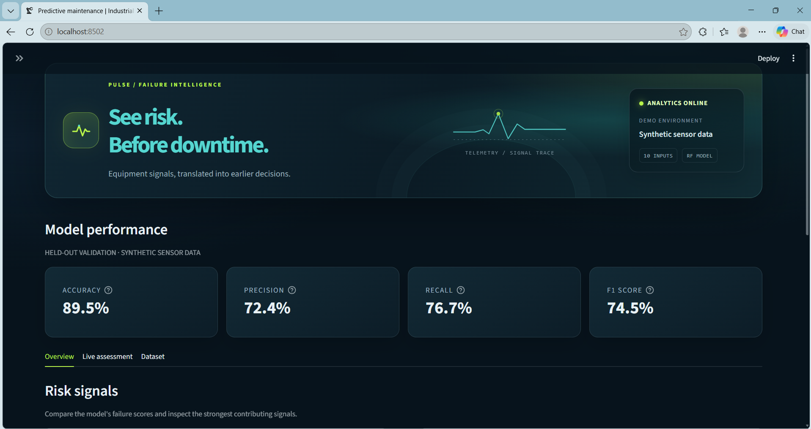
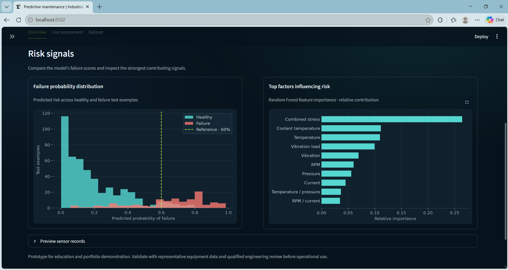
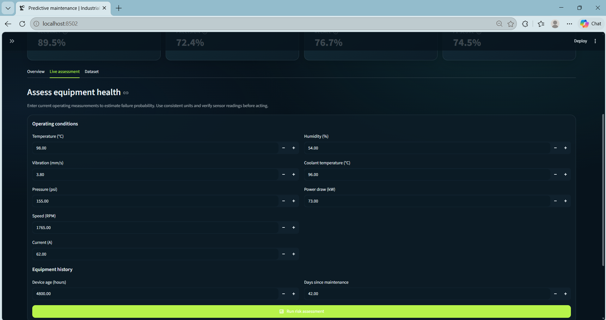
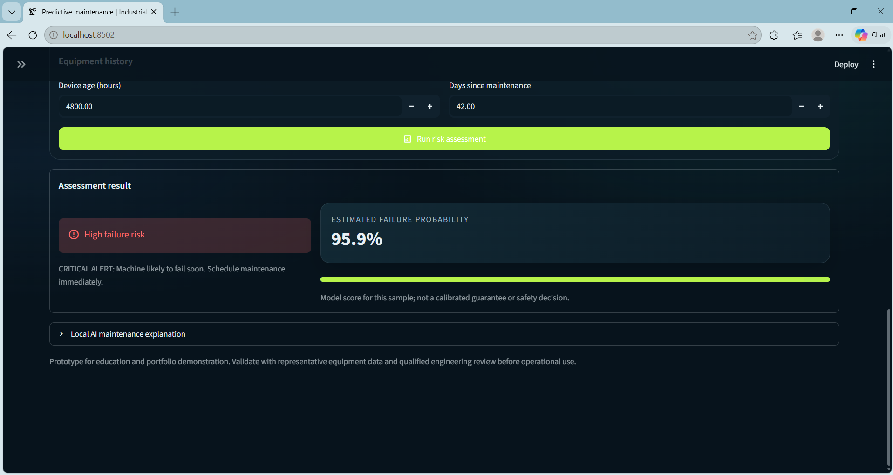
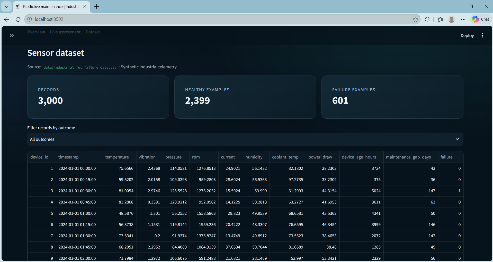
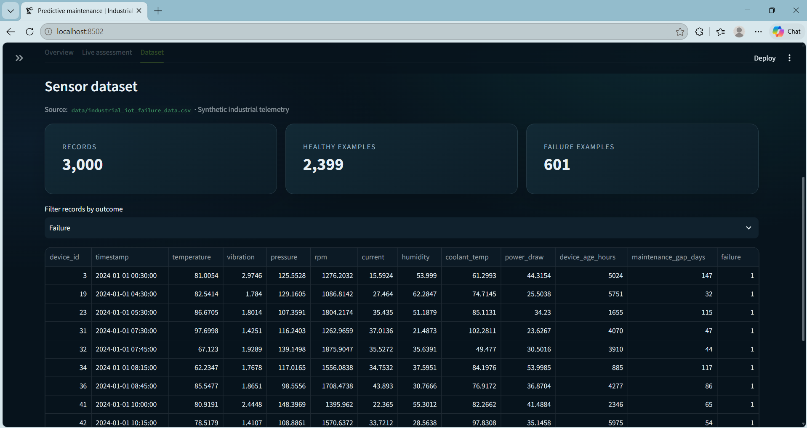
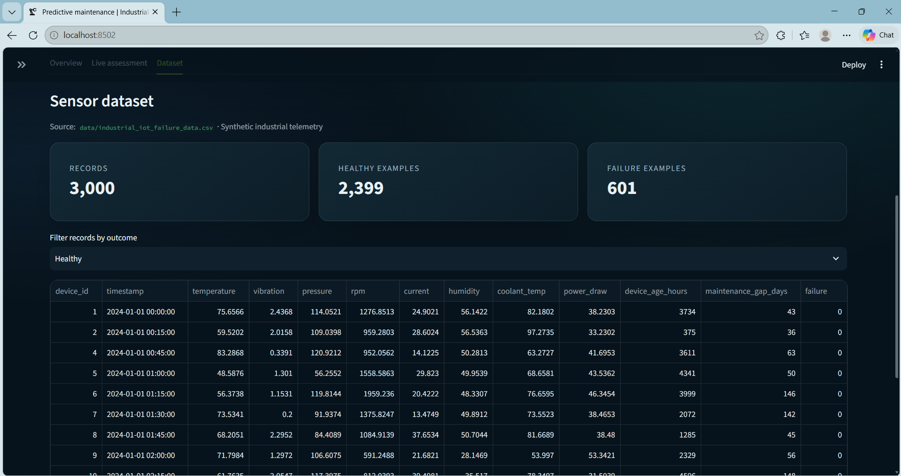
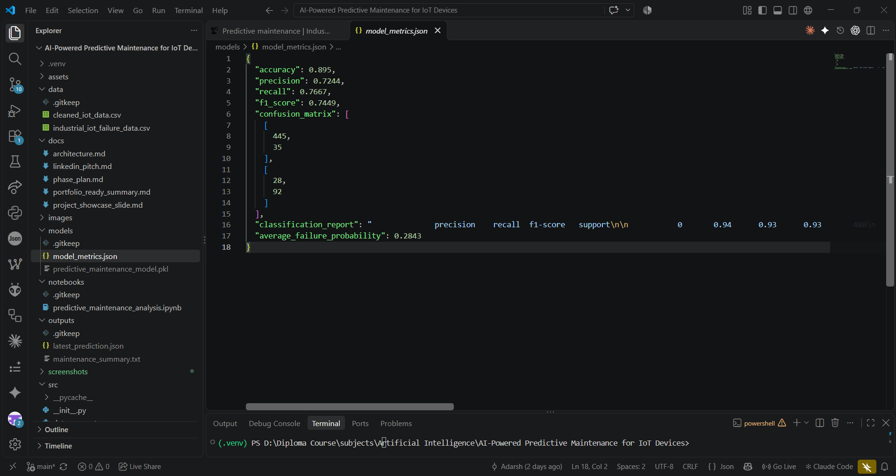
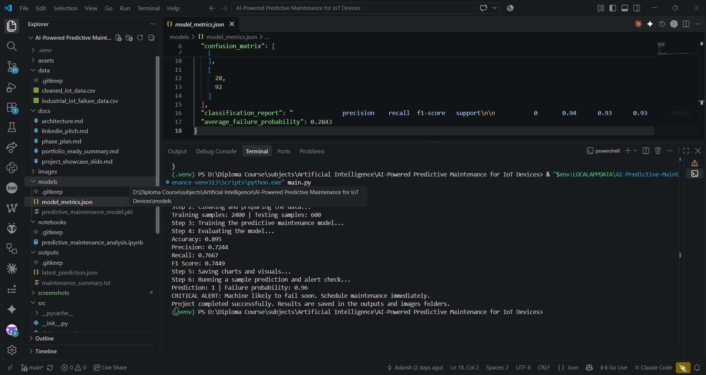
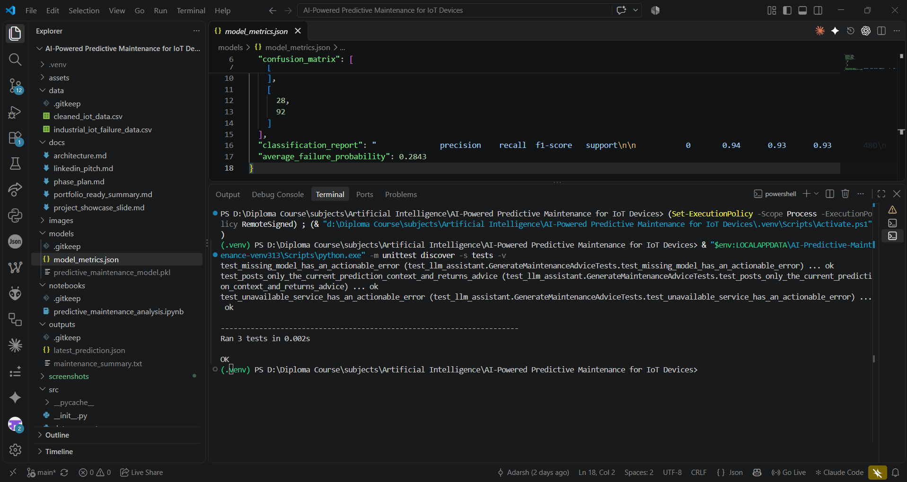

# AI-Powered Predictive Maintenance for IoT Devices

> An interactive industrial IoT prototype that uses synthetic equipment sensor data and a machine-learning classifier to estimate failure risk, surface maintenance alerts, and explore equipment health through a Streamlit dashboard.

---

## 👨‍💻 Author

**Adarsh Srivastav**<br>
Computer Science and Engineering (CSE) Student<br>
Embedded Systems | IoT | Python | AI

---

## 📌 Project Overview

The **AI-Powered Predictive Maintenance for IoT Devices** project demonstrates an end-to-end workflow for estimating industrial equipment failure risk from sensor telemetry.

The pipeline generates or loads a synthetic dataset, cleans the records, engineers additional health indicators, and trains a scikit-learn Random Forest classifier. Users can review model metrics and sensor data in a Streamlit dashboard, enter a device's current readings to get a prediction, and optionally request explanatory maintenance advice from a locally running Ollama model.

> **Project note:** This is a software-only learning and portfolio prototype. It uses synthetic data and has not been validated against physical equipment or real industrial telemetry. It is not a certified safety or industrial-control system.

---

## 🎯 Objectives

- Demonstrate a complete predictive-maintenance machine-learning workflow.
- Generate reproducible synthetic industrial sensor data.
- Clean and prepare sensor data and engineer derived features.
- Train and evaluate a failure-risk classifier.
- Present model metrics, data, and feature importance in an interactive dashboard.
- Accept sensor readings for an individual failure-risk prediction.
- Produce threshold-based maintenance alerts.
- Offer optional, local LLM-generated explanations without changing classifier predictions.
- Save datasets, model metrics, charts, and prediction reports for inspection.

---

## ✨ Key Features

- Synthetic industrial IoT dataset generation
- Ten sensor and equipment input features
- Four engineered machine-health features
- Random Forest classification pipeline with class balancing
- Stratified train/test split and standard classification metrics
- Interactive Streamlit dashboard
- Dark industrial control-room interface with a custom PULSE identity, risk-focused colors, and overview, live assessment, and dataset views
- Live failure-risk prediction from user-entered sensor values
- Risk-score visualization and feature-importance chart
- Alert levels for elevated failure probability
- Optional local Ollama maintenance assistant
- Command-line end-to-end workflow
- Docker and Docker Compose support
- Jupyter notebook for analysis
- Unit tests for local LLM assistant behavior

---

## 🏗️ System Architecture

```text
Synthetic IoT Sensor Data
          │
          ▼
Data Loading and Cleaning
          │
          ▼
Feature Engineering
          │
          ▼
Train/Test Split ──────► Random Forest Training
                                  │
                                  ▼
                         Model Evaluation
                                  │
             ┌────────────────────┴───────────────────┐
             ▼                                        ▼
    Streamlit Dashboard                       Saved Model/Metrics
             │
             ├── Live Failure-Risk Prediction
             ├── Threshold-Based Alert
             └── Optional Local Ollama Explanation
```

---

## 🔄 Working Principle

```text
Generate or Load Sensor Records
              ↓
Clean Data and Prepare Failure Labels
              ↓
Engineer Equipment-Health Features
              ↓
Split Data Into Training and Test Sets
              ↓
Train and Evaluate the Classifier
              ↓
Enter Current Sensor Readings
              ↓
Predict Failure Class and Probability
              ↓
Display Risk, Alert, Charts, and Optional Advice
```

### Sensor Inputs

The generated dataset includes the following input measurements:

| Input | Description |
|---|---|
| Temperature | Equipment temperature |
| Vibration | Measured vibration level |
| Pressure | Operating pressure |
| RPM | Rotational speed |
| Current | Electrical current |
| Humidity | Ambient humidity |
| Coolant temperature | Cooling-system temperature |
| Power draw | Equipment power consumption |
| Device age | Accumulated operating hours |
| Maintenance gap | Days since the previous maintenance |

The preprocessing pipeline adds four derived features: temperature-to-pressure ratio, vibration-load index, RPM-to-current ratio, and a combined stress index.

### Prediction and Alert Logic

The classifier returns a predicted class and a probability of failure. The alert helper uses the following probability levels when the predicted class indicates failure:

```text
Predicted failure and probability >= 0.60  → CRITICAL ALERT
Predicted failure and probability >= 0.40  → WARNING
Otherwise                                  → NORMAL
```

The dashboard's risk-threshold slider controls the reference line in the probability chart; the alert levels above are defined separately in the prediction helper.

---

## 🧠 Model and Evaluation

The project trains a scikit-learn `Pipeline` with a `StandardScaler` and a class-balanced `RandomForestClassifier`. Data is split into training and test sets with an 80/20 stratified split and a fixed random seed.

The currently checked-in evaluation snapshot in `models/model_metrics.json` reports:

| Metric | Snapshot |
|---|---:|
| Accuracy | 0.8950 |
| Precision | 0.7244 |
| Recall | 0.7667 |
| F1 score | 0.7449 |

Confusion matrix for that snapshot (actual rows, predicted columns):

```text
                 Predicted healthy  Predicted failure
Actual healthy          445                 35
Actual failure           28                 92
```

These figures are a recorded result for the current synthetic dataset and model settings, not a guarantee of real-world performance. Regenerating data or changing the training setup can change the results.

---

## 🖥️ Dashboard

The Streamlit dashboard provides:

- Accuracy, precision, recall, and F1 score
- An **Overview** tab with risk distribution, feature importance, and a sensor-record preview
- A **Live assessment** tab with grouped inputs and a risk result card
- A **Dataset** tab with record counts and outcome filtering
- A predicted class, probability score, and maintenance alert
- An optional local LLM explanation for the latest prediction
- A control to generate a fresh synthetic dataset and retrain the model

Run the dashboard locally and open `http://localhost:8501`.

---

## 🤖 Optional Local LLM Assistant

The dashboard can request maintenance advice from an Ollama model running on a local or otherwise explicitly configured endpoint. The classifier remains responsible for the prediction; the LLM only explains the result and suggests inspection steps.

By default, the dashboard uses `http://localhost:11434` and `qwen2.5:0.5b`. Configure these with `OLLAMA_BASE_URL` and `OLLAMA_MODEL`. The assistant sends the current form readings, classifier result, probability, and alert to the configured Ollama endpoint. It does not call a third-party LLM API directly.

Example local setup:

```bash
ollama pull qwen2.5:0.5b
ollama serve
```

Only configure an Ollama endpoint that you trust. Recommendations are advisory and should be checked against equipment documentation by a qualified maintenance professional.

---

## 🧰 Software and Tools

- **Language:** Python 3.10+
- **Data processing:** Pandas, NumPy
- **Machine learning:** scikit-learn
- **Visualization:** Matplotlib, Seaborn
- **Dashboard:** Streamlit
- **Model persistence:** Joblib
- **Notebook:** Jupyter
- **Optional local LLM:** Ollama
- **Containerization:** Docker and Docker Compose
- **Version control:** Git and GitHub

---

## 📁 Project Structure

```text
AI-Powered-Predictive-Maintenance-for-IoT-Devices/
├── .dockerignore
├── .gitignore
├── .streamlit/
│   └── config.toml                # Dark industrial theme and dashboard palette
├── Dockerfile
├── README.md
├── app.py                         # Interactive Streamlit dashboard
├── docker-compose.yml             # Dashboard and optional Ollama services
├── main.py                        # Command-line end-to-end workflow
├── requirements.txt
├── data/
│   ├── cleaned_iot_data.csv       # Generated by the preprocessing workflow
│   └── industrial_iot_failure_data.csv
├── docs/
│   ├── architecture.md
│   ├── linkedin_pitch.md
│   ├── phase_plan.md
│   ├── portfolio_ready_summary.md
│   └── project_showcase_slide.md
├── images/                        # Generated charts (PNG files are ignored by Git)
├── models/
│   ├── model_metrics.json
│   └── predictive_maintenance_model.pkl  # Generated locally; ignored by Git
├── notebooks/
│   └── predictive_maintenance_analysis.ipynb
├── outputs/
│   ├── latest_prediction.json     # Generated locally; ignored by Git
│   └── maintenance_summary.txt    # Generated locally; ignored by Git
├── screenshots/                   # Captured project evidence
├── src/
│   ├── __init__.py
│   ├── data_generator.py
│   ├── llm_assistant.py
│   ├── model_building.py
│   ├── prediction.py
│   ├── preprocessing.py
│   └── visualization.py
└── tests/
    └── test_llm_assistant.py
```

Generated and ignored artifacts may not exist until you run the project. The repository uses `images/` for generated plots rather than a separate screenshots folder, and keeps project-specific technical and portfolio documentation in `docs/`.

---

## ▶️ How to Run the Project

### 1. Install dependencies

Use Python 3.13 for the most straightforward Windows setup (the Docker image also uses Python 3.13). Create and activate a virtual environment from the repository root, then install dependencies:

**Windows PowerShell**

```powershell
py -3.13 -m venv .venv
.\.venv\Scripts\Activate.ps1
python -m pip install -r requirements.txt
```

If the Python launcher cannot find 3.13, install Python 3.13 or use the matching executable path shown by `py -0p`. Python versions newer than the project's tested runtime may not have compatible wheels for every dashboard dependency.

**macOS/Linux**

```bash
python3 -m venv .venv
source .venv/bin/activate
python -m pip install -r requirements.txt
```

### 2. Run the command-line workflow

```bash
python main.py
```

The script generates synthetic data, preprocesses it, trains and evaluates the model, saves charts and prediction output, and writes a maintenance summary.

### 3. Run the dashboard

```bash
streamlit run app.py
```

Open `http://localhost:8501` in a browser.

### 4. Run with Docker Compose

```bash
docker compose up --build -d
docker compose exec ollama ollama pull qwen2.5:0.5b
```

Open `http://localhost:8501`. The Ollama model download is optional for model training and dashboard predictions, but is required for local LLM advice.

### 5. Run the notebook

```bash
jupyter notebook notebooks/predictive_maintenance_analysis.ipynb
```

---

## 📦 Generated Outputs

Running the project creates or updates:

- `data/industrial_iot_failure_data.csv` — generated synthetic sensor data
- `data/cleaned_iot_data.csv` — cleaned data with engineered features
- `models/predictive_maintenance_model.pkl` — serialized trained model
- `models/model_metrics.json` — evaluation metrics
- `images/confusion_matrix.png` — confusion-matrix visualization
- `images/feature_importance.png` — feature-importance visualization
- `images/failure_probability.png` — probability visualization
- `outputs/latest_prediction.json` — most recent CLI prediction report
- `outputs/maintenance_summary.txt` — CLI run summary

The `.gitignore` excludes the generated model file, output reports, and chart images. They are produced locally when running the relevant workflow.

---

## 🧪 Testing

Run the existing unit tests from the repository root:

```bash
python -m unittest discover -s tests -v
```

The current automated tests cover the local Ollama assistant request payload and actionable errors when the service or requested model is unavailable. Model metrics in the README refer to the recorded evaluation snapshot, not a full automated test suite.

---

## 📸 Project Evidence

The following captures document the running Streamlit prototype, synthetic-data workflow, generated model artifacts, and automated tests. These are software-validation screenshots; they do **not** show physical sensor measurements or prove hardware validation.

| # | Evidence | Screenshot |
|---:|---|---|
| 1 | PULSE dashboard overview, model metrics, and synthetic-data notice |  |
| 2 | Failure-probability distribution and feature importance |  |
| 3 | Live assessment form and sensor inputs |  |
| 4 | Example high-risk assessment using the sample input |  |
| 5 | Dataset explorer with record totals and all outcomes |  |
| 6 | Dataset filtered to failure-labeled examples |  |
| 7 | Dataset filtered to healthy-labeled examples |  |
| 8 | Saved evaluation metrics and trained model artifact |  |
| 9 | Successful command-line training and prediction workflow |  |
| 10 | Existing unit tests passing |  |

---

## ⚠️ Limitations

- Training and evaluation data are synthetic, not collected from physical equipment.
- The model's predictions are demonstrations and should not be used to make real maintenance or safety decisions.
- Model performance on synthetic data does not establish performance on real machines.
- No live IoT sensor ingestion or physical device integration is implemented.
- The dashboard trains the model locally when it starts and can take time on slower machines.
- The optional Ollama service requires a locally available model and adequate system resources.
- Recommendations produced by an LLM may be inaccurate and require human review.
- Authentication, production deployment security, monitoring, and a cloud backend are not implemented.

---

## 🚀 Future Scope

- Train and validate with representative, labeled industrial telemetry.
- Add configurable data sources and live sensor ingestion.
- Compare additional classifiers and calibrate predicted probabilities.
- Add time-series features and equipment-specific models.
- Track prediction history and maintenance actions in a database.
- Add model versioning, drift monitoring, and retraining workflows.
- Add authenticated user roles and production deployment controls.
- Extend dashboard reporting and export options.
- Add domain-reviewed maintenance recommendations and alert routing.

---

## 🎓 Skills Demonstrated

### Data Science and Machine Learning

- Data cleaning and preparation
- Feature engineering
- Classification and train/test splitting
- Model evaluation and interpretation
- Probability-based risk communication

### Python Engineering

- Modular project structure
- Reproducible workflows
- JSON and CSV data handling
- Unit testing
- Model serialization

### Applications and Deployment

- Interactive Streamlit dashboards
- Docker and Docker Compose
- Local LLM integration
- Project documentation and version control

---

## 📚 Documentation

Additional project material is available in:

- `docs/architecture.md` — system workflow and module overview
- `docs/phase_plan.md` — development phases
- `docs/portfolio_ready_summary.md` — portfolio summary
- `docs/project_showcase_slide.md` — presentation material
- `docs/linkedin_pitch.md` — short project description
- `notebooks/predictive_maintenance_analysis.ipynb` — exploratory analysis

---

## 🔬 Project Status

### ✅ Functional Software Prototype

The project includes a reproducible synthetic-data workflow, Random Forest training and evaluation, a Streamlit dashboard, a command-line workflow, and optional local Ollama explanations. It has not been validated with physical equipment or real-world industrial data.

---

## ⭐ Conclusion

The **AI-Powered Predictive Maintenance for IoT Devices** project demonstrates how sensor-data preparation, feature engineering, machine learning, interactive visualization, and optional local language-model explanations can be combined in a small industrial analytics prototype.

```text
SYNTHETIC SENSOR DATA
        ↓
DATA PREPARATION
        ↓
FEATURE ENGINEERING
        ↓
FAILURE-RISK MODEL
        ↓
PREDICTION + ALERT
        ↓
STREAMLIT DASHBOARD
        ↓
OPTIONAL LOCAL MAINTENANCE EXPLANATION
```

The implementation is a starting point for experimentation. Real deployment would require representative equipment data, rigorous validation, safety review, secure operations, and qualified human oversight.

---

**Project Status: ✅ Functional Software Prototype | 📊 Synthetic Data | 🌐 Streamlit Dashboard | 🤖 Optional Local Ollama Assistant**
